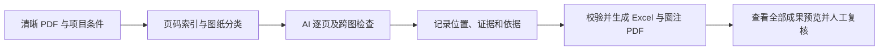
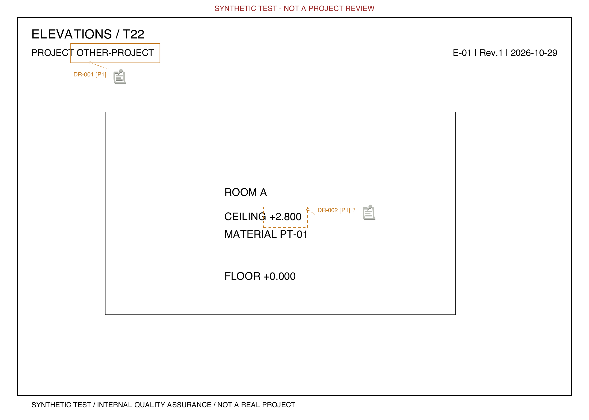
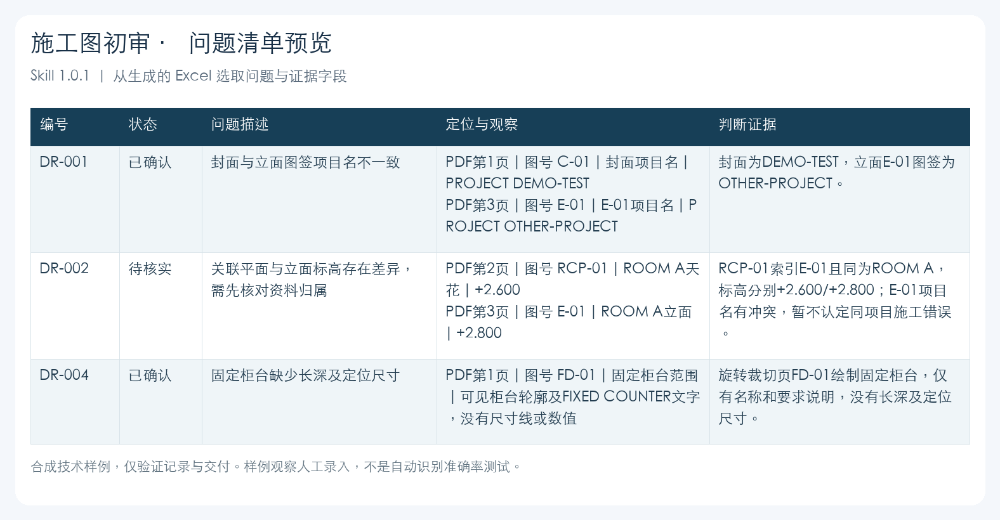

# AI 室内施工图初审

将图纸检查中的分类、证据记录、问题定位和成果复核整理为可追溯的 AI 工作流程，协助设计团队开展出图前内部初审。

**项目案例展示，完整工具不公开提供。** 当前案例对应 Skill **1.0.1**，输入为室内施工图 PDF。

## 业务问题

图纸反馈常以口头沟通或零散截图传递，问题位置、关联证据和检查依据不易对应。跨图矛盾需要来回翻页，审核覆盖情况也容易与「没有记录问题」混淆。

项目将这些工作整理成明确的检查状态和交付要求，让问题能够定位、依据能够追溯、尚未完成的检查能够被看见。

## 个人贡献

项目由丁雨推进，工作重点是把设计审核要求转化为业务人员可使用、可复核的 AI 流程：

- 整理检查分类、检查要求和来源映射，形成 4 个分组、23 类图纸、108 项检查的体系。
- 设计问题、位置、证据、严重程度和修改优先级的记录方式。
- 组织 AI 看图取证、程序校验、Excel 清单和 PDF 圈注的交付流程。
- 使用合成样例检查来源链接、跨图证据、圈注位置和未完成检查的处理方式。

## 工作流程

模型负责查看图纸、取证和判断；程序负责记录一致性检查、报告生成与文件校验。检查项区分未发现问题、发现问题、待核实、不适用和未检查。

## 成果示例

图为程序生成的技术合成图纸与圈注，展示问题编号和位置对应关系，不属于真实客户项目。

清单展示部分合成问题的编号、状态、位置和观察证据。样例观察由合成图纸人工录入，用于验证交付结构，**不作为自动识别准确率测试**。

实际交付包括问题清单 Excel、编号圈注 PDF、审核摘要、全部圈注页预览和校验记录。完整工具中的问题来源可跳转到报告内嵌检查表，支持复核原文；本案例不公开内部检查表。

## 验证记录

2026-11-04 使用 Python 3.12 对指定发布包重新验证：

| 检查内容 | 验证范围 |
|---|---|
| 原始发布文件 | 16 个文件逐一核对 |
| 程序回归检查 | 34 项通过 |
| PDF 处理 | 旋转、裁切、原页保留及圈注定位 |
| 证据与输出 | 跨图证据、来源单元格链接、问题与位置记录对应 |
| 未完成检查 | 不允许将未完成覆盖导出为完整审核结论 |

测试结果用于说明程序行为和交付可靠性。本案例不主张实际项目覆盖数、提效比例或图纸识别准确率。

## 适用边界

- 需要能够查看图像、读取本地文件和运行程序的 AI 环境，不直接读取 DWG。
- 随包检查体系属于示例审核基准，使用前需要确认项目适用范围。
- 内部控制口径不等同于法规要求；结构、电气、消防等专业结论及计算仍需专业人员复核。
- 对扫描不清、资料归属不明或缺少适用条件的问题，保留待核实状态。
- 导出后仍需查看成果预览并人工复核，初审不能替代正式审查。

完整 Skill、规则、脚本及检查表保存在私有仓库。此处只展示业务流程、合成成果和验证摘要。

相关案例：[通用 AI 施工报价工具](https://github.com/tintin-dingyu/ai-construction-quotation-case)。
